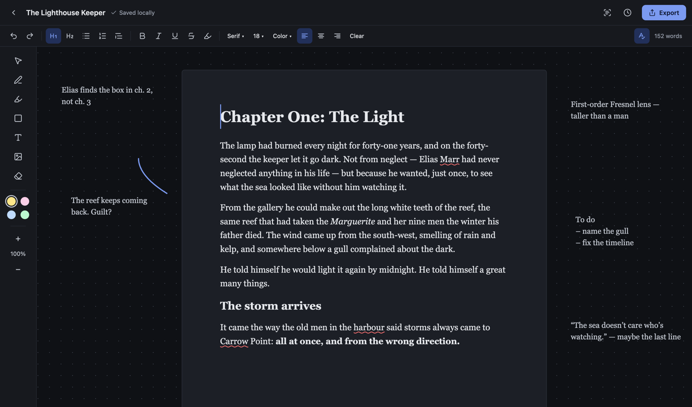
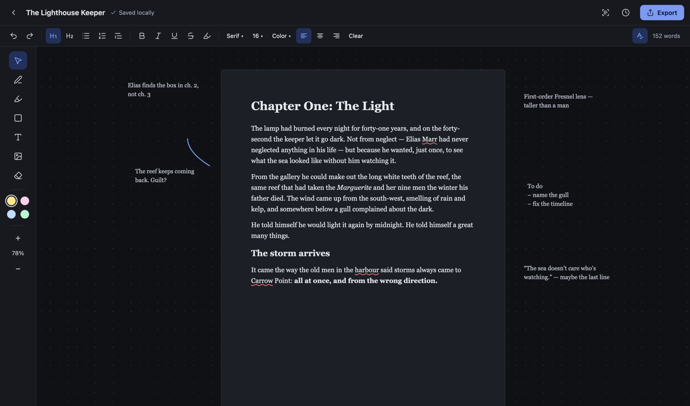
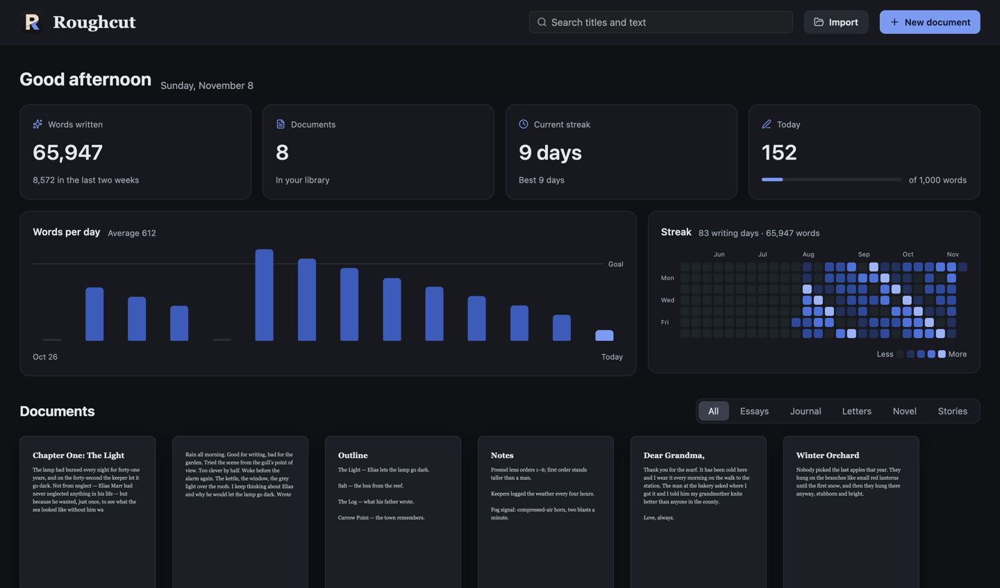
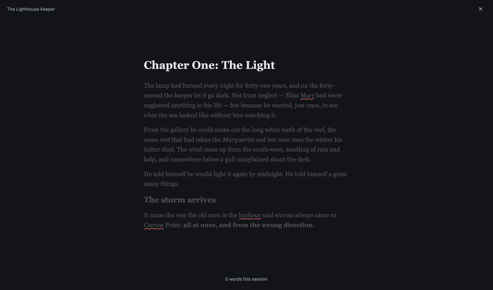

A local writing app for macOS. Pages, a whiteboard, and room to think.

**[Download for macOS (Apple Silicon)](https://github.com/jediknight813/Roughcut/releases/latest)**

```sh
cargo run -p quill
```

| Pages | Whiteboard |
| --- | --- |
|  |  |
| Library | Focus |
|  |  |
